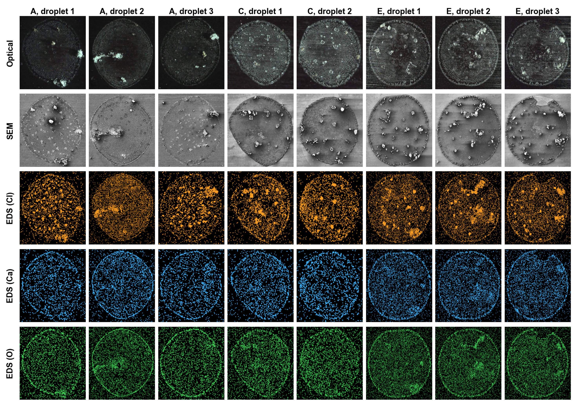
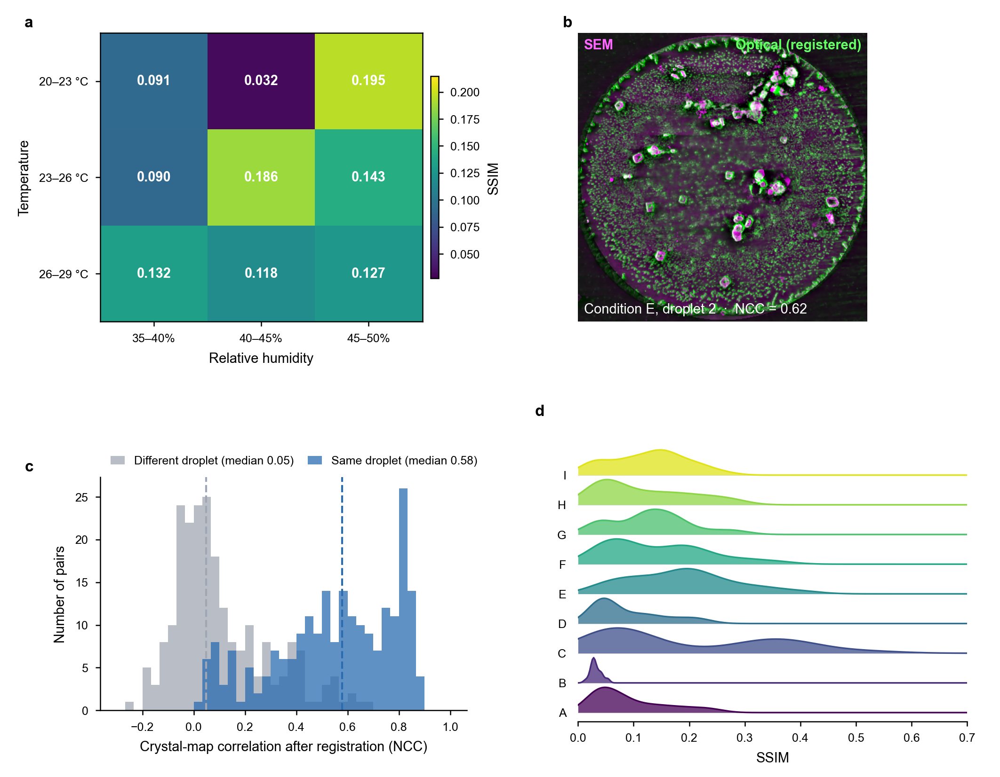

# A Physically Grounded Multi-modal Imaging Dataset of Evaporative Coffee Ring Deposits

[](https://doi.org/10.5281/zenodo.19271331)


Analysis and figure code for a multi-modal imaging dataset of dried water droplets. Each of the 225 deposits was imaged with three instruments that rely on different physical contrast: digital optical microscopy (reflected visible light), scanning electron microscopy (electron–matter interaction), and energy-dispersive X-ray spectroscopy (characteristic X-ray emission). Because all three observe the same physical deposit, their correspondence comes from shared structure rather than human annotation.

The dataset itself is on Zenodo: <https://doi.org/10.5281/zenodo.19271331> (this DOI always resolves to the latest version).

<p align="center">
  
  <br>
  <em>Eight replicate droplets of water Sample 1 from conditions A, C and E. Rows: optical microscope, SEM, and EDS maps of Cl, Ca and O. Brightness is adjusted for display only.</em>
</p>

## Dataset at a glance

| Property | Details |
|---|---|
| Modalities | Digital optical microscopy (Celestron 5 MP, 100×, 1280×1024) · SEM (JEOL JSM-6610LV, 12 kV, 50×, 2560×1920) · EDS maps of C, Ca, Cl, Mg, Na, O, S (630×472) |
| Samples | 225 deposits = 5 synthetic water compositions × 5 replicate droplets × 9 environmental conditions |
| Conditions | 3 × 3 factorial: temperature 20–23, 23–26, 26–29 °C × relative humidity 35–40, 40–45, 45–50 % (A–I) |
| Water compositions | Five synthetic waters based on Michigan water-quality reports; ionic strength 3.7–12.0 mM |
| Images | 2,475: 225 optical, 225 SEM, 1,575 EDS, 450 preprocessed optical and SEM |
| Features | 91 image-level features per pair, 129 features for the multivariate analyses, optical-to-SEM registration of every pair |

Within each condition directory, files 1–5 belong to water Sample 1, 6–10 to Sample 2, and so on.

## Cross-modal validation

<p align="center">
  
  <br>
  <em>(a) Mean SSIM of registered optical and SEM images per condition. (b) A registered pair: SEM in magenta, optical in green. (c) Crystal-map correlation for the same droplet versus a different droplet. (d) SSIM distribution per condition.</em>
</p>

The optical images are rotated by about 276° relative to SEM and imaged at a different magnification, so every pair is registered before comparison (`experiment/cross_modal_registration.py`). After registration the crystal features of the two modalities correlate with a median NCC of 0.58 for the same droplet and 0.05 for a different droplet (223 of 225 pairs higher; Wilcoxon p < 10⁻³⁸).

## Repository

```
experiment/                 analysis scripts and their CSV outputs
  cross_modal_registration.py   optical-to-SEM registration and registered SSIM
  registration_null.py          matched versus mismatched droplet reference
  complete_cv_analysis.py       image-level feature extraction
  particle_morphometry.py, spatial_statistics.py, radial_distribution_analysis.py, fractal_dimension.py
  eds_validation_analysis.py, eds_divergence_analysis.py, multivariate_statistics.py
figures_src/                code that generates every manuscript figure
  make_all.py                   python figures_src/make_all.py
  style.py                      shared style (Arial 7 pt, 180 mm width)
  fig1_coffee_ring.py … fig4_ssim.py
  assets/                       the two photographs that cannot be generated
assets/                     images used in this README
```

Scripts expect the dataset unpacked into `data/` at the repository root (`data/optical`, `data/sem`, `data/eds`, `data/corrected_images`, `data/features`, `data/metadata`).

## Loading a registered pair

```python
import cv2, numpy as np, pandas as pd
from pathlib import Path

root = Path("data")
def to_width(img, w=640):
    return cv2.resize(img, (w, round(img.shape[0] * w / img.shape[1])), interpolation=cv2.INTER_AREA)

optical = to_width(cv2.imread(str(root / "corrected_images/B/Image_3.jpg"), cv2.IMREAD_GRAYSCALE))
sem = to_width(cv2.imread(str(root / "corrected_images/B/SEM_3.jpg"), cv2.IMREAD_GRAYSCALE))

reg = pd.read_csv(root / "features/cross_modal_registration.csv")
row = reg[(reg.condition == "B") & (reg.image_id == 3)].iloc[0]
M = np.array([[row.M00, row.M01, row.M02], [row.M10, row.M11, row.M12]])
optical_in_sem_frame = cv2.warpAffine(optical, M, sem.shape[::-1])
print("registration NCC", row.registration_ncc)   # treat pairs below 0.3 with caution
```

## Requirements

Python 3.10 with numpy, pandas, scipy, scikit-image, scikit-learn, opencv-python, matplotlib, seaborn, statsmodels and Pillow.

## Citation

```bibtex
@misc{li2026coffeering,
  author    = {Li, Xiaoyan and Jiang, Cuicui and Lahr, Rebecca},
  title     = {A Physically Grounded Multi-modal Imaging Dataset of Evaporative Coffee Ring Deposits},
  publisher = {Zenodo},
  year      = {2026},
  doi       = {10.5281/zenodo.19271331}
}
```

## Authors

Xiaoyan Li (Tsinghua University; Michigan State University; lixiaoy5@msu.edu), Cuicui Jiang (Inner Mongolia University), Rebecca Lahr (Michigan State University; corresponding author, rlahr@a2gov.org).

## License

Code: MIT. Dataset on Zenodo: CC BY 4.0.
