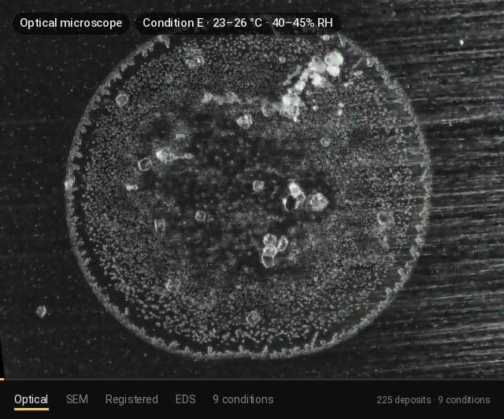

<div align="center">

# Coffee-Ring Multimodal Dataset

**A physically grounded multi-modal imaging dataset of evaporative coffee-ring deposits**

Optical microscopy · Scanning electron microscopy · Energy-dispersive X-ray spectroscopy

[](https://doi.org/10.6084/m9.figshare.34516902)
[](https://github.com/xiaoyanLi629/coffee-ring-multimodal-dataset/releases/latest)
[](#requirements)
[](LICENSE)
[](https://creativecommons.org/licenses/by/4.0/)

[Dataset](#get-the-data) · [Experimental design](#experimental-design) · [Data layout](#data-layout) · [Validation](#cross-modal-validation) · [Reproduce](#reproduce-the-analyses) · [Citation](#citation)

<br>



<sub>One deposit (condition E, water Sample 1) as seen by the three instruments, the optical and SEM images after registration (SEM magenta, optical green, white where both record a crystal), its Ca, Cl, S and Na maps, and the same water under all nine conditions. Brightness and EDS maps are enhanced for display.</sub>

</div>

<br>

When a drop of water evaporates, its dissolved salts are carried to the edge and crystallise into a coffee-ring deposit whose structure depends on the water's chemistry and on the temperature and humidity during drying. This dataset records **225 such deposits**, each imaged by three instruments whose contrast comes from different physics: reflected visible light, electron–matter interaction and characteristic X-ray emission. Because the three modalities observe the same physical object, their correspondence is fixed by physics rather than by human annotation, which makes the dataset a testbed for cross-modal and multimodal learning as well as for studies of evaporative crystallisation and image-based water analysis.

This repository holds the analysis and figure code. The data are archived on figshare.

<table align="center">
  <tr>
    <td align="center"><b>225</b><br><sub>deposits</sub></td>
    <td align="center"><b>3</b><br><sub>imaging modalities</sub></td>
    <td align="center"><b>9</b><br><sub>temperature × humidity conditions</sub></td>
    <td align="center"><b>5</b><br><sub>synthetic waters</sub></td>
    <td align="center"><b>2,475</b><br><sub>images</sub></td>
    <td align="center"><b>129</b><br><sub>features per deposit</sub></td>
  </tr>
</table>

## Get the data

The dataset (about 480 MB, CC BY 4.0) is published on figshare at **<https://doi.org/10.6084/m9.figshare.34516902>** as five zip archives that unpack into `data/`. The helper script downloads them, checks each MD5 against figshare and unpacks them; it needs only the Python standard library.

```bash
git clone https://github.com/xiaoyanLi629/coffee-ring-multimodal-dataset.git
cd coffee-ring-multimodal-dataset
python download_data.py                          # all five archives
python download_data.py features_metadata        # or only the tables (0.4 MB)
```

| Archive | Size | Contents |
|---|---:|---|
| `optical.zip` | 48 MB | original optical microscope images |
| `sem.zip` | 84 MB | original SEM images and their instrument parameter files |
| `eds.zip` | 86 MB | EDS maps of seven elements, as exported by the instrument |
| `corrected_images.zip` | 264 MB | preprocessed optical and SEM images used for the features |
| `features_metadata.zip` | 0.4 MB | features, registration, conditions, compositions and quality metrics |

> An earlier, uncorrected version of the data on Zenodo ([10.5281/zenodo.19271331](https://doi.org/10.5281/zenodo.19271331)) is superseded by the figshare record.

## Experimental design

Five synthetic waters, formulated from the annual drinking-water quality reports of municipal water systems in southern Michigan (2017–2019) and spanning ionic strengths of 3.7–12.0 mM, were deposited as 2 µL droplets on polished aluminium by an automated sampler inside an environmental chamber. Each water was dried in five replicate droplets under each of nine conditions, a 3 × 3 factorial of temperature and relative humidity:

<div align="center">

| Temperature \ RH | 35–40 % | 40–45 % | 45–50 % |
|:---:|:---:|:---:|:---:|
| **20–23 °C** | A | B | C |
| **23–26 °C** | D | E | F |
| **26–29 °C** | G | H | I |

</div>

Every deposit was imaged first optically and then in the SEM, where the EDS maps were acquired from the same field.

| Modality | Instrument | Contrast | Image size | Pixel size | Files |
|---|---|---|---|---|---:|
| Optical | Celestron 5 MP digital microscope, 100× | reflected visible light | 1280 × 1024 | not calibrated | 225 |
| SEM | JEOL JSM-6610LV, 12 kV, 50×, SEI | secondary electrons | 2560 × 1920 | 1.0 µm (nominal) | 225 |
| EDS | integrated detector, same field as SEM | characteristic X-rays of C, Ca, Cl, Mg, Na, O, S | 630 × 472 | ≈ 4.1 µm | 1,575 |

The SEM pixel size follows from the instrument's magnification, which is referenced to a 128 mm wide image: at 50× an image covers 2.56 mm × 1.92 mm of the substrate.

## Data layout

```
data/
├── optical/<A–I>/Image_<n>.jpg           original optical images
├── sem/<A–I>/SEM_<n>.jpg, <n>.txt        original SEM images, instrument parameters
├── eds/<A–I>/<n>/<element> Kα1.png       EDS maps, seven per deposit
├── corrected_images/<A–I>/               preprocessed optical and SEM images
├── features/
│   ├── comprehensive_computer_vision_features.csv    91 image features per pair
│   ├── combined_features_129.csv                     129 features, µm units
│   └── cross_modal_registration.csv                  optical-to-SEM transforms
└── metadata/
    ├── environmental_conditions.csv      temperature and humidity of A–I
    ├── sample_compositions.csv           solutes and ionic strength of the waters
    ├── image_processing_statistics.csv   brightness before and after preprocessing
    └── image_quality_metrics.csv         focus and exposure of every original image
```

Here `<n>` runs from 1 to 25 within each condition: deposits 1–5 come from water Sample 1, 6–10 from Sample 2, and so on up to Sample 5.

## Cross-modal validation

<p align="center">
  
</p>
<p align="center"><sub>(a) Mean SSIM of registered optical and SEM images per condition. (b) A registered pair, SEM in magenta and optical in green. (c) Crystal-map correlation for the same droplet versus a different droplet. (d) SSIM distribution per condition.</sub></p>

The optical images are rotated by about 276° relative to the SEM images and recorded at a different magnification, so every pair is registered before comparison. After registration the crystal maps of the two modalities correlate with a median NCC of **0.58** for the same droplet against **0.05** for a different droplet; the same-droplet score is higher for 223 of 225 pairs (Wilcoxon p < 10⁻³⁸). EDS signal coverage follows the known composition of the waters, most clearly for sulfur.

<details>
<summary><b>Load a registered optical–SEM pair</b></summary>

```python
import cv2, numpy as np, pandas as pd
from pathlib import Path

root = Path("data")
def to_width(img, w=640):
    return cv2.resize(img, (w, round(img.shape[0] * w / img.shape[1])), interpolation=cv2.INTER_AREA)

optical = to_width(cv2.imread(str(root / "corrected_images/B/Image_3.jpg"), cv2.IMREAD_GRAYSCALE))
sem = to_width(cv2.imread(str(root / "corrected_images/B/SEM_3.jpg"), cv2.IMREAD_GRAYSCALE))

reg = pd.read_csv(root / "features/cross_modal_registration.csv")
row = reg[(reg.condition == "B") & (reg.image_id == 3)].iloc[0]
M = np.array([[row.M00, row.M01, row.M02], [row.M10, row.M11, row.M12]])
optical_in_sem_frame = cv2.warpAffine(optical, M, sem.shape[::-1])
print("registration NCC", row.registration_ncc)   # treat pairs below 0.3 with caution
```

</details>

<details>
<summary><b>Notes on data quality</b></summary>

<br>

Every original image was screened for focus and exposure, and the results are stored per image in `metadata/image_quality_metrics.csv`. No image is out of focus or over-exposed. Three acquisition irregularities are worth knowing about. Twenty-two optical images, 21 of them from condition B, were taken with lower exposure; their deposits remain clearly resolved. The SEM images of Sample 5 in condition C (files 21–25) were recorded with a darker background setting, although their instrument parameters match the other images. The first nine SEM images of condition A were recorded with a different spot size. Registration quality is lower (NCC < 0.3) for 37 pairs, mostly from condition B, whose deposits contain few distinct crystals. The Mg and O maps carry a contribution from the 6061 aluminium substrate, which contains magnesium and an oxide layer.

</details>

## Reproduce the analyses

With the data in `data/`, each script below regenerates its results; `python figures_src/make_all.py` rebuilds every manuscript figure.

| Analysis | Script |
|---|---|
| Optical-to-SEM registration and registered SSIM | `experiment/cross_modal_registration.py` |
| Matched versus mismatched droplet reference | `experiment/registration_null.py` |
| Image-level feature extraction | `experiment/complete_cv_analysis.py` |
| Particle morphometry, spatial and radial statistics, fractal dimension | `experiment/particle_morphometry.py`, `spatial_statistics.py`, `radial_distribution_analysis.py`, `fractal_dimension.py` |
| EDS composition validation and divergence | `experiment/eds_validation_analysis.py`, `eds_divergence_analysis.py` |
| PERMANOVA and discriminant analysis | `experiment/multivariate_statistics.py` |
| Manuscript figures | `figures_src/fig1_coffee_ring.py` … `fig4_ssim.py` |
| Animation in this README | `figures_src/readme_gif.py` |

### Requirements

Python 3.10 or later. Install the dependencies with `pip install -r requirements.txt`; the versions listed are the ones the results were produced with.

## Citation

If you use the dataset, please cite it:

```bibtex
@misc{li2026coffeering,
  author       = {Li, Xiaoyan and Jiang, Cuicui and Lahr, Rebecca},
  title        = {A Physically Grounded Multi-modal Imaging Dataset of Evaporative Coffee Ring Deposits},
  howpublished = {figshare},
  year         = {2026},
  doi          = {10.6084/m9.figshare.34516902}
}
```

If you use the code, please also cite the release you used, for example [v1.0.1](https://github.com/xiaoyanLi629/coffee-ring-multimodal-dataset/releases/tag/v1.0.1).

## Authors

**Xiaoyan Li** — Department of Automation, Tsinghua University; Department of Computational Mathematics, Science and Engineering, Michigan State University · lixiaoy5@msu.edu<br>
**Cuicui Jiang** — College of Computer Science, Inner Mongolia University<br>
**Rebecca Lahr** (corresponding author) — Department of Civil and Environmental Engineering, Michigan State University · rlahr@a2gov.org

SEM and EDS data were acquired at the Center for Advanced Microscopy, Michigan State University.

## License

The code in this repository is released under the [MIT License](LICENSE). The dataset on figshare is released under [CC BY 4.0](https://creativecommons.org/licenses/by/4.0/).
